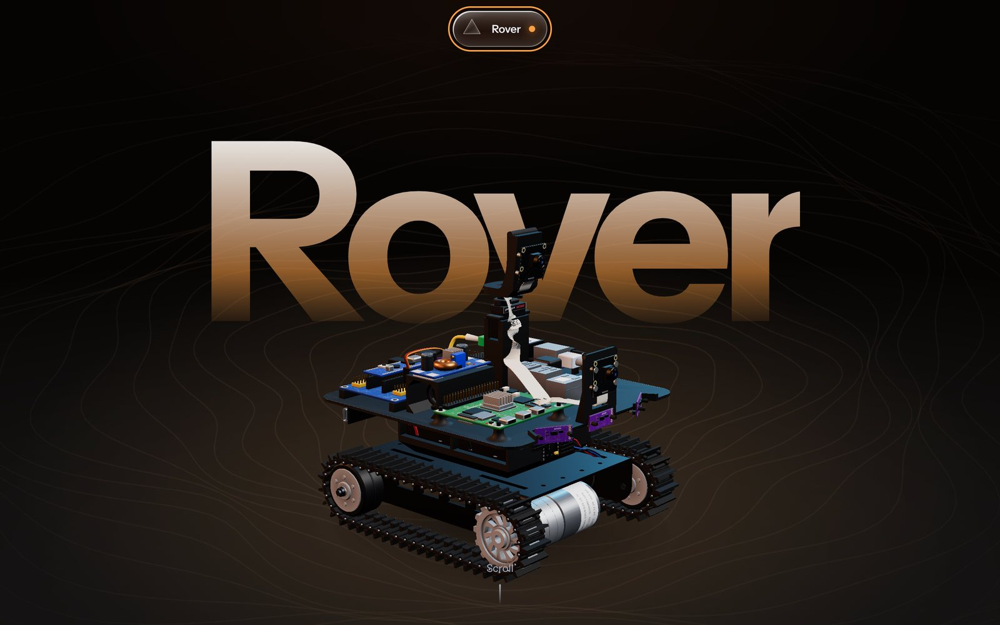

# Radu Matei

My personal website: who I am, what I have built, and my thesis robot, the DataLink Rover, which you can take apart in 3D.


## What it is

- One page with six sections: Home, Projects, DataLink Rover, Record, About and Contact. The menu is a glass prism at the top of the screen.
- Plain HTML, CSS and JavaScript. There is no framework and no build step for the site itself.
- The light in the background is drawn by `light.js` in a Web Worker, so it stays smooth while the page is busy. Browsers without workers or OffscreenCanvas draw it on the main thread instead.
- The rover and its controller are real 3D models (three.js). The rover is built part by part to real dimensions, and the controller comes from its CAD file. The page loads light versions first. On devices that can handle more, it swaps in detailed versions, and it switches back if the frame rate drops.



## Folder structure

```
site/                    the website; this folder is what gets published
├── index.html           the page, with its styles and main script
└── assets/
    ├── js/              light.js (background light), datalink-3d.js (3D viewer)
    ├── models/          packed 3D models and their texture, built by tools/
    └── img/             photos
tools/                   Python build for the 3D models (see tools/README.md)
docs/                    screenshots for this README
.github/workflows/       publishes site/ to GitHub Pages
```

## Run it locally

Open the page through a local web server. Browsers block parts of it (the worker and the 3D textures) when `index.html` is opened straight from disk.

```
cd radu-matei
python3 -m http.server 8000 --directory site
```

Then open http://localhost:8000. On Windows, use `python` instead of `python3`.

## Publish it on GitHub Pages

1. Create an empty repository on GitHub, without a README or licence. If you name it `<your-username>.github.io`, the site is served at `https://<your-username>.github.io/`. With any other name, it is served at `https://<your-username>.github.io/<repo-name>/`.
2. Push this folder:

   ```
   cd radu-matei
   git init -b main
   git add .
   git commit -m "First version of the site"
   git remote add origin https://github.com/<your-username>/<repo-name>.git
   git push -u origin main
   ```

3. On GitHub, open **Settings → Pages**. Under **Build and deployment**, set **Source** to **GitHub Actions**.
4. Open the **Actions** tab, choose **Deploy site to GitHub Pages**, and press **Run workflow**. The run started by the first push fails, because Pages was not switched on yet.

From then on, every push to `main` that changes `site/` publishes the site again (`.github/workflows/pages.yml`).

## Your own domain or server later

- **Your own domain on GitHub Pages:** in **Settings → Pages → Custom domain**, enter the domain and save. Then add the DNS records from GitHub's guide, [Managing a custom domain for your GitHub Pages site](https://docs.github.com/en/pages/configuring-a-custom-domain-for-your-github-pages-site/managing-a-custom-domain-for-your-github-pages-site). With this workflow, no `CNAME` file is needed.
- **Your own server:** the site is static files, so any web server works (nginx, Apache, Caddy). Copy the contents of `site/` into the server's web root.

## The 3D models

The files in `site/assets/models/` are generated by `tools/build_models.py` from my CAD meshes. You only need to run it if you change a model. Setup and details are in [tools/README.md](tools/README.md).

## Secrets

The site contains no passwords, keys or private addresses.

A static site cannot keep a secret. Every visitor downloads everything in `site/`, so never put a key or password there. If the tools ever need one, put it in a `.env` file. `.gitignore` keeps `.env` files and the Python `.venv` folder out of the repository.

## Credits

- [three.js](https://threejs.org/) 0.160.0 (MIT licence), loaded from jsDelivr.
- Instrument Sans and IBM Plex Mono from Google Fonts (SIL Open Font License).
- DejaVu Sans for the labels painted into the 3D textures, in `tools/fonts/` (licence included).

© 2026 Radu Matei. All rights reserved.
